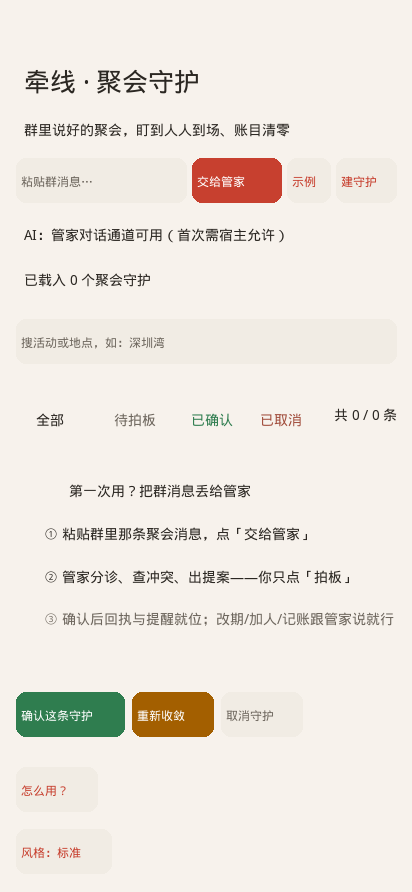
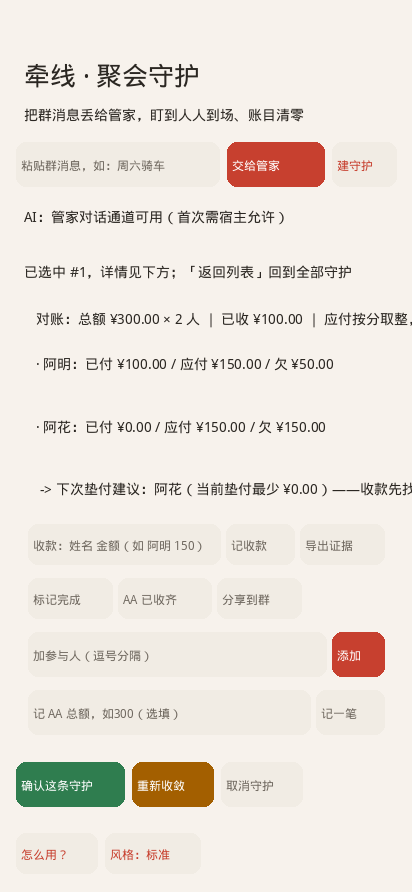
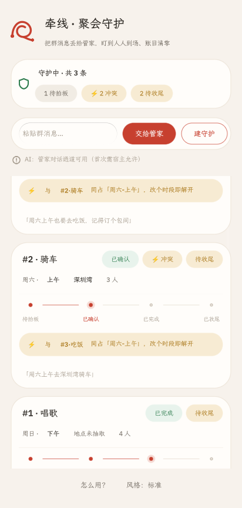

#  牵线 · 聚会筹办守护（qianxian）

> 📄 **一分钟读懂这个作品** → [evidence/one-pager.md](evidence/one-pager.md)
> （做了什么 / 为什么这么设计 / 怎么核验 / 怎么跑 / 已知边界，一页纸）

> **一条群消息，长成一个被照顾到收尾的完整活动。**
> 本作品是**活动生命周期守护**（Case 状态机），不是聊天增强——聊天只是意图的入口和结果的回执通道。

- **当前版本 v0.10.0**（`hub check — PASSED`，contract 1.10.0，agent read-only 最小权限 + AGENT.md v4）。
  **Kimi Coding Plan 真模型管家**（octos 内核原生 moonshot-coding family）× **Rinx 真宿主**全链实测：
  create/mark_paid（正例+否定）/export/clear（危险两段拍板）/改期 diff 卡——cases.json 落盘断言全过。
  回归 **29/29**，渲染错误 0。
- **决赛主线（管家模式）**：**agent 驱动全流程，人只做最终拍板**——
  粘贴群消息点「交给管家」→ agent 抽取字段/查冲突/真工具查天气 → **PLAN 机器提案**（12 op 全集）→
  提案卡上点「拍板」→ 白名单动作执行 + 回执。**ops 覆盖矩阵**（[evidence/ops-coverage.md](evidence/ops-coverage.md)）：
  全部 18 个状态变更函数逐行标注，一行不空。**agent 可操性矩阵**（[evidence/operability-matrix.md](evidence/operability-matrix.md)）：
  12 个 PLAN op × 五个入口逐格挂证据——真内核 op 链 12/12 全绿（R-35/36）。
- **提案可信度**：**diff 提案卡**（旧值 ──▶ 新值 + 改期冲突预演纯试算，拍板前看清「变了什么」）；
  **提案出处高亮**（字段在原文中的位置【】标出）；**拒绝并改写**（放弃时选理由，
  理由注入下一轮，agent 从被拒中改道）；**白名单前置校验**（无 id / 不在名单 / 非法参数一律拒——
  真机实锤拒绝文案）。
- **账目闭环**：**全员余额列表**（成员 | 已付 | 欠/清/多垫；**按分取整舍入写死，总计恒等 ✓**）+
  「谁该付下一笔」事前消解；**梯度催收四段式**（事前/T+1 系统口吻/T+3 私发名单/T+7 最后一催——
  **永不公示名单**，数字全由代码算，模型零参与）。
- **主动守护的分寸**：**守护灯常驻条**（待拍板/冲突/待收尾确定性摘要——主动信息的「家」）；
  **沉默留痕**（守护进程「考虑过但没说的事」可回看可审计——全场独有差异化）；
  **三级提醒**（T-7d/T-24h/活动日晨）+ **天气主动复核**（降水 ≥60% 才预警，附来源+日期，
  无雨/查不到就沉默但留痕）。
- **日历**（双通路）：确认即生成标准 ICS（任何日历软件可导入）；**device_calendar 系统日历写链**
  （RC2 官方协议，确认拍板后原生面板物理确认——用户只点确认；Linux 宿主诚实降级 ICS）。
- **v0.8.0 证据**：[v080-features-20261012.md](evidence/v080-features-20261012.md)；
  **v0.9.0 证据**：[v090-features-20261012.md](evidence/v090-features-20261012.md)（含 v0.9.1/0.9.2 UI 增补）
- **主场景**：日历（时间收敛、**冲突检测**、待定 vs 已确认）
  → 与官方「日历」场景四步演示的逐条对齐见
  **[evidence/official-scenario-alignment.md](evidence/official-scenario-alignment.md)**
- **比赛**：GOSIM Agentic App 黑客松 2026（队伍 Aurora-X）；初赛入围（73/100）
- 🎥 **演示视频 v0.10.0**（全部实机帧录制，UI 与当前版本一致）：
  用户视角五幕（[群消息→守护](evidence/demo-videos/01-group-message.mp4) /
  [冲突裁决](evidence/demo-videos/02-conflict.mp4) / [AA 闭环](evidence/demo-videos/03-aa.mp4) /
  [管家实录](evidence/demo-videos/04-butler.mp4) / [群智收敛](evidence/demo-videos/05-converge.mp4)）；
  端到端功能验证七套在 [evidence/scenarios/](evidence/scenarios/)。
  （历史：[Release v0.9.2 资产](https://github.com/kkkkikun/qianxian-guardian/releases/tag/v0.9.2)）

## 界面预览（v0.10.0）

| 守护列表（守护灯卡 + 红线生命周期） | 详情（对账表 + 恒等注脚 + 垫付建议） | 冲突态（琥珀横幅 + 双卡） |
|---|---|---|
|  |  |  |

> 来源标注：截图为 card-host 宿主**真实渲染帧**（`/g?wait=1` 后端抓帧，非重绘）——
> 徽章底色、冲突琥珀横幅、红线朱砂段均为运行时真实绘制。评审可用 `tools/octo shot` 复核，
> 或在 Rinx 真宿主导入 bundle 实机对照。

## 它做什么

群里一句「周六上午去深圳湾骑车，大概两小时？」之后：

```
粘贴群消息 → 交给管家（octos.turn.start 真回合）
  → agent 抽字段+查冲突+真工具查天气（抽取不到的字段留空显示「未抽取到」，绝不编造）
  → 回复尾部输出单行 PLAN{...} 机器提案
  → diff 提案卡：旧值──▶新值 + 冲突预演 + 出处【】高亮
  → 人点「拍板执行」→ 白名单动作（12 op 全集）→ 落盘 + 回执
  → 冲突检测：同日同时段互标 → 改一个时段即自动解开
  → 状态全生命周期：待拍板→已确认→已完成→已收尾（红线肉眼可见地推进）
  → AA 对账表 + 收齐自动清零；梯度催收起草；证据包可导出（离线校验）
```

**守护多了也不乱**：**守护灯卡**（确定性摘要 chips）+ 搜索框 + 五标签筛选（全部/待拍板/
已确认/完成/已取消），带「共 N / M 条」计数，两者可叠加。

**四条最高法则**：

1. **不编造**：抽不到的时间/活动/地点一律留空显示「未抽取到」，不猜、不填。
2. **用户始终主动**：分诊不确定时给澄清卡 +「仍然建守护」入口，不替用户做决定。
3. **危险操作留退路**：取消/清空是两段式确认（8 秒窗），且 5 秒内可撤销。
4. **矛盾交人裁决**：检测到同时段冲突只提示不自作主张；改一个时段即可自动解冲突。
5. **数据在用户手里**：可导出（屏显 JSON 供复制）、可一键清空、损坏自动备份。

失败不掩盖：无 AI 服务→明确降级继续可用 · 分诊未命中→澄清卡说明原因 ·
损坏数据→备份后重启不丢 · 重复确认→「已确认，未重复」。

## 管家模式：AI 接管全流程，用户只拍板

「交给管家」是主入口（朱砂主按钮）。管家 = 底层 **octos agent**（`octos.turn.start` 真回合，
app 把角色提示词与当前守护快照嵌入 turn 文本——不依赖宿主注入 AGENT.md）：

```
群消息 → 交给管家 → agent 抽字段+查冲突+工具调用 → 回复尾部输出单行机器提案：
  PLAN{"op":"create","text":"原文","activity":"骑车","slot_day":"周六","slot_part":"上午",...}
→ app 解析进提案卡（槽位词表归一；缺 id / 无溯源原文 / 不在名单一律拒）
→ 人点「拍板执行」→ 白名单动作 → sys 回执 + 撤销窗口照常；agent 绝不声称已改状态
```

- **PLAN op 全集（12 个）**：`create / confirm / reschedule / cancel / add_people / set_bill /
  complete / draft_dunning / mark_paid / undo / clear / export`——app 的全部状态变更
  （含危险操作两段拍板与撤销窗语义）都可由 agent 提案驱动。
- **合法性前置校验**：create 必须带消息原文（溯源）、目标 id 必须存在、改期/加人必须有值、
  mark_paid 的 who 必须在参与人名单——非法提案拍板即拒并给拒绝文案（真机实锤）。
- **双处一致**：`bundle/AGENT.md` v4（官方四段式 + 机器可读 op 表）与 app 内提示词、
  `tools/qx-kernel-turn.py` 三处同文；agent 工具最小权限（read-only + `ask_user_question`）。
- **真模型实证**：内核直连（mock + **Kimi 真模型** 双证 PLAN 合规 + function calling）；
  Rinx 真宿主多轮 e2e：create / 改期 diff 卡 / mark_paid（正例+否定）/ export / clear 两段——
  全部落盘断言（[evidence/s4-real-host-20261010.md](evidence/s4-real-host-20261010.md)、
  [v090-features](evidence/v090-features-20261012.md)）。

## 无 AI 也完整可用

本应用**不依赖任何模型服务**：分诊、时间槽抽取、冲突检测、状态机、对账全部是确定性规则。
无 AI 宿主时点「交给管家」**明确降级**（sys 气泡明示原因），本地规则路径（「建守护」）完整可用；
屏上有常驻能力可见性行，如实显示「可用 / 实测无响应 / 本机无服务」。

## 怎么审这个作品（三条路，从零门槛到完整复现）

**① 零门槛：直接读源码**（不需要任何构建）
本应用是纯解释执行的脚本，核心逻辑都在一个文件里：
`bundle/main.splash`（约 4200 行，Splash/OctoScript 方言；函数名即语义：butler_send / plan_parse /
build_plan_lines / butler_approve / rebuild_selected_ledger / rebuild_lines …）。
配套阅读：[evidence/ops-coverage.md](evidence/ops-coverage.md)（ops 覆盖矩阵）、
[evidence/v090-features-20261012.md](evidence/v090-features-20261012.md)（v0.9.0 特性验证）、
[app/qianxian/tools/qx-verify-v2.py](app/qianxian/tools/qx-verify-v2.py)（**25 项真机回归**，
`QX_PORT=8146 python3 …` 一键跑）、[evidence/s4-real-host-20261010.md](evidence/s4-real-host-20261010.md)
（Rinx 真宿主×真模型端到端证据）。

**② 门禁核验**（需要上游 `hub` 工具；约 5 分钟）
> 注意：`OctoSense-App-Hub` 把 makepad / Octoscript patch 到**兄弟路径**，
> 只 clone 它一个仓**编不出来**（实测报 `failed to read ../makepad/…/Cargo.toml`）。
> 用官方的一键脚本把兄弟仓拉齐：
```sh
git clone https://github.com/OctoSense-org/OctoScript-App-Design-Flow.git
cd OctoScript-App-Design-Flow && python3 tools/setup-native.py   # 拉齐 makepad/octoscript/octoscript-makepad
cd ../OctoSense-App-Hub
cargo build --release -p octosense-app-hub --bin hub
./target/release/hub check <你的-clone>/my-entry/bundle --allow-unsigned
# 期望：qianxian 0.10.0 — PASSED（仅 unsigned warning）
```

**③ 完整复现**（需 card-host 运行时；见 [run.md](run.md)）
```sh
cd my-entry/app/qianxian
export OCTOSENSE_APP_HUB=../../../.build-hub-926/OctoSense-App-Hub   # 或按 run.md B 段自建
python3 ../../../octosense-ws/OctoScript-App-Design-Flow/tools/octo run bundle --port 8141
```

- **怎么用**：见 **[evidence/demo-script.md](evidence/demo-script.md)**（21 步三线：主线 / 冲突检测 / 危险操作与数据控制；每步输入都经真机验证）。
- **复现与版本锁定**：见 **[run.md](run.md)**。
- **门检**：`python3 $OCTO check bundle` → 目标 `— PASSED`（仅 unsigned warning）。

## 目录

> 一仓一应用：本仓库只提交「牵线」一个应用；`bundle/` 位于仓库根（App Hub 硬性要求，门禁有断言锁死）。

```
bundle/     THE SUBMISSION：manifest/listing/main.splash/icon/截图
bundle-src/            main.splash 的 16 个源码部件（编辑这里；tools/qx-pack.sh 拼接生成 bundle/main.splash）
app/guardian/            场外链路证明（同一套设计在真实 Matrix + 真实 LLM 通道跑通，
                         G1–G5 六套冒烟 70+ 断言全绿）
app/miniapp-qianxian/    旧 Rinx spike（已归档，被 app/qianxian 取代）
tools/                   验证与伴生工具：qx-verify-v2（回归驱动）/ qx-kernel-turn（内核直连）/
                         qx-reminder-bridge（三级提醒+天气复核+沉默留痕守护进程）/
                         qx-evidence-check（证据包离线校验）/ demo-video-v092（视频生成）/
                         snap-to-png（控件树重绘）/ qx-rinx-variant（Rinx 变体生成）
evidence/                验收与证据：ops-coverage（ops 矩阵）/ v080/v090 特性验证 /
                         regression / demo-script / ux-specs / splash-constraints /
                         submission-readiness / qianxian review 包 + 7 问作答
PRIVACY.md               隐私政策（无网络 + 本机存储 + 用户可导出/清空）
task.md                  任务说明与 12 条验收条件
blueprint-gpt.md         设计蓝图（v0.7.1 冻结，四轮对抗评审）
run.md                   复现步骤 / 版本锁定
GOAL.md changes.md       执行总纲与变更记录
```

## 提交形态与验收

- **为什么选 script-app**（四条官方形态逐一对照）→ [evidence/submission-form-decision.md](evidence/submission-form-decision.md)
- **验收条件逐条映射**（task.md 的 guardian 口径 → script-app 实际）→ [evidence/acceptance-mapping.md](evidence/acceptance-mapping.md)

## 设计依据

交互与可用性规范（含第一方系统应用逐条对照）见
**[evidence/ux-specs.md](evidence/ux-specs.md)**；完整状态机与防编造校验链见
**[blueprint-gpt.md](blueprint-gpt.md)** v0.7.1。

## 许可证

Apache License 2.0 — 见 [LICENSE](LICENSE)。
