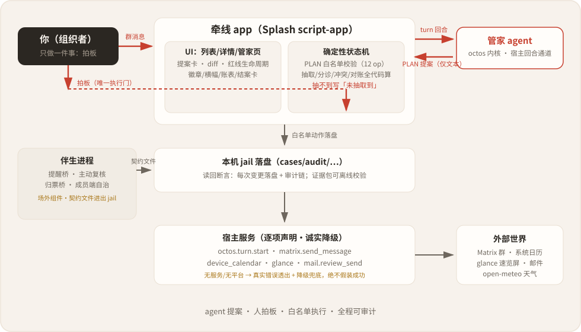
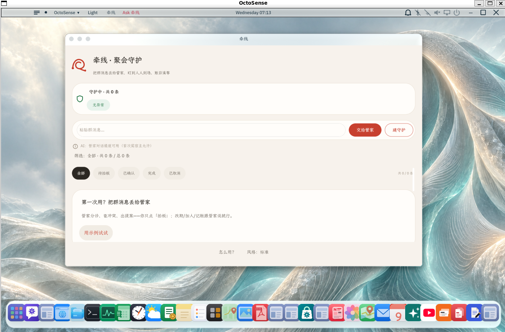

<div align="center">
  
  <h1>牵线 · 聚会筹办守护</h1>
  <p><b>一条群消息，长成一个被照顾到收尾的完整活动。</b></p>
  <p>
    
    
    
    
    
  </p>
  <p>
    <a href="#快速开始">快速开始</a> ·
    <a href="#工作原理">工作原理</a> ·
    <a href="evidence/finals-verification-map.md">核验地图</a> ·
    <a href="changes.md">变更台账</a>
  </p>
  <p><b><a href="https://www.bilibili.com/video/BV1djp66AEfA/">📺 演示视频（B 站，103 秒，配音+字幕）</a></b></p>
</div>

牵线是运行在 OctoSense 里的 Splash 小程序（script-app）：把群里的聚会消息丢给管家，
**agent 只做提案，人只做拍板**——管家抽取字段、查冲突、起草 PLAN 机器提案，
你点「拍板」才走白名单动作落地；之后它盯到人人到场、账目清零。
无 AI 服务的设备上自动降级本地规则，功能完整可用。

## 功能

- **一句话成守护**：粘贴群消息点「交给管家」，agent 抽时间/地点/活动，抽不到就留空写「未抽取到」，绝不编造。
- **PLAN 提案 · 人拍板**：12 个 op 全集（建/确认/改期/取消/加人/记账/收款/完成/催收草稿/撤销/清空/导出），diff 卡看清「变了什么」，白名单前置校验（缺 id/非法参数一律拒）。
- **红线生命周期**：待拍板 → 已确认 → 已完成 → 已收尾，同时段撞期双卡互标琥珀横幅，改个时段红线肉眼可见地解开。
- **AA 对账闭环**：成员 | 已付 | 应付 | 状态四列账表，按分取整、总计恒等；「谁该付下一笔」事前消解；梯度催收草稿（数字全代码算，名单永不公示）。
- **主动守护有分寸**：三级提醒（T-7d/T-24h/活动日晨）+ 天气复核（降水 ≥60% 才预警）；**沉默留痕**——考虑过但没说的事可回看可审计。
- **群体协调**：时间收敛投票（文字投票卡降级路径）+ 成员端自治投票（确定性规则，模型不替人表态）；结案回顾一键分享群/邮件（人审）。
- **日历双通路**：确认即生成标准 ICS；`device_calendar` 系统日历写链（原生面板物理确认，不支持的宿主诚实降级）。
- **最小权限 + 可审计**：能力逐项声明（hub check PASSED），每次状态变更写审计链，证据包导出可离线校验。

## 快速开始

**环境要求**

- 官方 [Rinx 1.3.0](https://github.com/hagency-org/Rinx/releases) 或 OctoSense App Hub 的 `card-host`（验证所用宿主）
- 使用真模型管家：宿主侧配好 octos 内核 profile（`moonshot-coding` family + Kimi Coding Plan key）

**本地导入**

```bash
git clone https://github.com/kkkkikun/qianxian-guardian.git
```

1. Rinx 里打开 **Mini apps → Import an app**，包路径填 `qianxian-guardian/bundle`。
2. 核对名称、版本与能力声明后 **Run**。或本地直跑：
   `card-host --bundle bundle --allow-unsigned --stamp --remote 8146`。
3. 没配 AI 也能用：点「建守护」走本地规则分诊，全功能完整。

完整复现步骤与版本锁定见 [run.md](run.md)。

## 使用

1. 粘贴群消息 → 点「交给管家」→ 看管家的提案卡 → 点「拍板执行」。
2. 撞期了：卡片出琥珀横幅，点详情里「改时间」，红线自动解开。
3. 聚会后：详情里「标记完成」→ 记 AA → 收齐自动清零 → 结案回顾卡一键分享。
4. 想看管家「为什么没说」：聊天页底部「沉默留痕」区。

## 工作原理

一句话：**agent 提案，程序校验，人来拍板。** 三道把关分别防三类问题：

| 问题 | 会发生什么 | 牵线的把关 |
| --- | --- | --- |
| 编造 | 模型写出原文没有的时间/地点/数字 | 只从原文抽取，抽不到留空写「未抽取到」；数字全由代码从状态机算，模型零参与 |
| 越权 | 模型直接改了状态 | PLAN 只是单行文本提案；白名单前置校验；人点「拍板」才执行；拒绝理由注入下一轮改写 |
| 打扰 | agent 频繁主动打扰 | 阈值不满足就沉默——但**留痕**：每条「考虑过没说」的决策都落盘可回看 |

### 架构一图

<p align="center">
  
  <br><sub>agent 只产出文本提案；拍板是唯一执行门；伴生进程不碰状态机，只读写契约文件</sub>
</p>

## 架构与权限

| 申请的服务 | 用途 |
| --- | --- |
| `storage` | 守护数据/审计链/偏好存本机 jail |
| `octos.turn.start` | 管家回合（宿主内核通道） |
| `matrix.send_message` | 确认回执/投票卡/结案分享发群（宿主真发） |
| `device_calendar` | 系统日历写链（原生面板物理确认；不支持则降级 ICS） |
| `glance` | 守护灯速览卡发布（L0 卡源，官方 check_card 校验在案） |
| `mail` | 催收/回顾的邮件人审通路（`mail.review_send`，物理确认才发） |

应用本身不联网；伴生进程（提醒/主动复核/群投票归票）是宿主侧场外组件，定位与 guardian 相同。
详见 [PRIVACY.md](PRIVACY.md) 与 [bundle/AGENT.md](bundle/AGENT.md)（agent 契约 v4）。

### 实机宿主实拍

官方 OctoSense 桌面 shell（源码构建）里作为系统应用运行（筛选/输入/建守护全可用）：

<p align="center">
  
  <br><sub>官方桌面 shell 实拍：牵线以系统应用身份运行，窗口内为 app 真实界面（2026-10-14）</sub>
</p>

## 界面预览（v0.10.1）

| 守护列表（守护灯卡 + 红线生命周期） | 详情（对账表 + 恒等注脚 + 垫付建议） | 冲突态（琥珀横幅 + 双卡） |
|---|---|---|
|  |  |  |

> 来源标注：截图为 card-host 宿主**真实渲染帧**（`/g?wait=1` 后端抓帧，非重绘）。
> 评审可用 `tools/octo shot` 复核，或在 Rinx 真宿主导入 bundle 实机对照。

**演示视频**（约 2 分钟，配音+字幕，实机帧录制）：
[evidence/finals-demo-v0.10.1.mp4](evidence/finals-demo-v0.10.1.mp4) · **[B 站观看（带配音）](https://www.bilibili.com/video/BV1djp66AEfA/)**；
用户视角五幕在 [evidence/demo-videos/](evidence/demo-videos/)，端到端功能验证七套在
[evidence/scenarios/](evidence/scenarios/)——全部实机录制、断言全过，可用
`tools/qx-scenario.py --scenario <文件> --frames … --video …` 复录。

## 测试

每改一次代码，全量门禁重跑。

| 测试 | 结果 | 说明 |
| --- | --- | --- |
| 端到端回归 | 40/40 通过 | `app/qianxian/tools/qx-verify-v2.py`，真 card-host 全链路+落盘断言 |
| 内核 op 链 | 12/12 op 合规 | `tools/qx-dialog-chain.py`，真内核 × 剧本 mock × 管家提示词 |
| 归票/自治/收敛自测 | 5/5 + 7/7 通过 | `tools/qx-converge.py`、`tools/qx-member-agent.py --selftest` |
| 双实例牵线 e2e | 16/16 断言通过 | `tools/qx-wp1-e2e.py`，palpo 双账号真实房间全链 |
| 打包检查 | `hub check` PASSED | 仅「未签名」提示；v0.10.1 起走 GitHub 签名发布流 |
| L0 卡源校验 | valid=true | 官方 `check_card`（速览卡源） |

## 项目结构

```text
bundle/                  应用包（manifest/listing/main.splash/图标/截图）——仓库根，一仓一应用
bundle-src/              main.splash 的 16 个源码部件（tools/qx-pack.sh 拼接生成）
app/guardian/            场外链路证明（真实 Matrix + 真实 LLM 通道，G1–G6 冒烟）
app/qianxian/tools/      回归驱动与校验工具（qx-verify-v2 等）
tools/                   伴生进程与内核直连/场景录制/证据校验工具
scripts/                 qx-gate-check.sh 门禁（版本自洽/包同步/hub check/密钥扫描/回归）
evidence/                验收证据与核验地图（ finals-verification-map.md 为索引）
run.md                   复现步骤与版本锁定
```

## 对 OctoSense 的贡献

**已提 PR**：

- [App-Hub PR #230](https://github.com/OctoSense-org/OctoSense-App-Hub/pull/230)：`network.hosts` 准入接受 `host:port`（修 [#214](https://github.com/OctoSense-org/OctoSense-App-Hub/issues/214)，61 项测试全绿）。
- [makepad PR #125](https://github.com/OctoSense-org/makepad/pull/125)：修复 [#213](https://github.com/OctoSense-org/OctoSense-App-Hub/issues/213)——Splash isolate 的 promise/任务队列在空闲事件循环下从不排空（定时器/网络回调 resolve 后 `await` 永不恢复）；带红绿钉住的回归测试，Wayland 真机零输入验证。
- [Rinx PR #91](https://github.com/hagency-org/Rinx/pull/91)：实现 [#90](https://github.com/hagency-org/Rinx/issues/90) 的 `matrix.edit_message`（m.replace）mini-app 服务，357+31 项测试全绿。
- [App Flow PR #190](https://github.com/OctoSense-org/OctoSense-App-Flow/pull/190)：snap-to-png 无头渲染工具（评审三连修复已推送）。
- [makepad PR #124](https://github.com/OctoSense-org/makepad/pull/124)：`net.HttpRequest ignore_ssl_cert` 脚本侧贯通回归测试（[#490](https://github.com/OctoSense-org/OctoSense/issues/490) 经复核为我们误判，已诚实撤回并关闭，测试留下防疑云）。

**收口评论**：[#489](https://github.com/OctoSense-org/OctoSense/issues/489) 日历提案按 `device_calendar` 落地重新定界；[octos #2768](https://github.com/octos-org/octos/issues/2768) 定时唤醒 RFC 补实现勘察（gateway 装配点钉死 + serve 侧三个待决设计问题）。

**PLAN 协议模式模板**：[evidence/plan-pattern-template.md](evidence/plan-pattern-template.md)（agent 提案→白名单校验→人拍板→落盘回执 四段式 + 机器可读 op 表）。

全部清单与状态：[evidence/upstream-contributions.md](evidence/upstream-contributions.md)。

## 文档

[核验地图](evidence/finals-verification-map.md) ·[变更台账](changes.md) · [复现步骤](run.md) ·
[隐私政策](PRIVACY.md) · [设计蓝图](blueprint-gpt.md) · [局限性](limitations.md)

## 许可证

[Apache License 2.0](LICENSE) · GOSIM Agentic App 黑客松 2026 决赛作品（队伍 Aurora-X）
