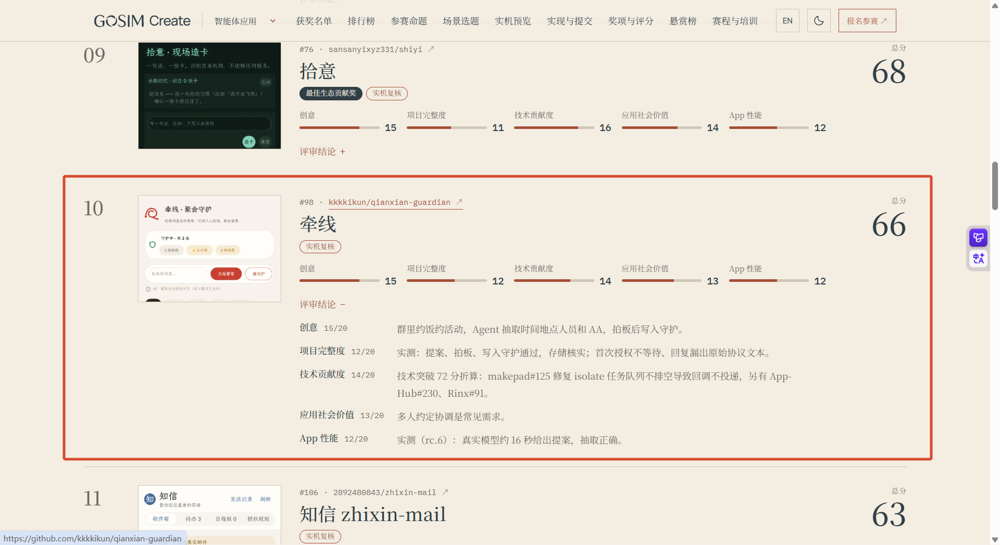

# 赛后复盘 · 我们与前三名的差距在哪里

> GOSIM Agentic App 黑客松 2026 决赛已收官。本文做三件事：
> ① 把决赛榜单、我们的得分与评委逐维度原话钉死；② 基于对前三名**公开仓库的一手调研**，
> 按决赛五个评分维度逐项对比；③ 给出差距归因与可执行动作。
>
> **事实基础**：初赛 73/100 入围（评审版 v0.1.0 @ `9c7c322`）；
> 决赛 **66/100，第 10 名**（[榜单截图](leaderboard-ours.png)，五维明细与评委原话均来自官方榜单页）。
> 对手信息全部来自其公开仓库（文末附来源），标注「推断」处是分析而非事实。

---

## 一、最终结果（确认事实）

| 名次 | 作品 | 总分 | 创意 | 项目完整度 | 技术贡献度 | 应用社会价值 | App 性能 | 奖项 |
|---|---|---|---|---|---|---|---|---|
| 1 | [OnCue 试映间](https://github.com/codezzzsleep/OnCue) | **80** | 15 | 18 | 16 | 15 | 16 | 一等奖 + MiniMax 意创万象大奖 |
| 2 | [冰箱管家 pantry-steward](https://github.com/woshuoduijiushidui/pantry-steward) | **77** | 14 | 17 | 13 | 16 | 17 | 二等奖 |
| 3 | [OctoBuddy](https://github.com/tyreseluo/OctoBuddy) | **74** | 17 | 14 | 14 | 12 | 17 | 二等奖 |
| … | | | | | | | | |
| 9 | 拾意 shiyi | 68 | 15 | 11 | 16 | 14 | 12 | 最佳生态贡献奖 |
| **10** | **牵线 · 聚会筹办守护（我们）** | **66** | **15** | **12** | **14** | **13** | **12** | 决赛入围 |
| 11 | 知信 zhixin-mail | 63 | — | — | — | — | — | — |

**评委逐维度原话（榜单页原文转录）：**

| 维度 | 得分 | 评委结论 |
|---|---|---|
| 创意 | 15/20 | 群里约饭约活动，Agent 抽取时间地点人员和 AA，拍板后写入守护。 |
| 项目完整度 | 12/20 | 实测：提案、拍板、写入守护通过，存储核实；**首次授权不等待、回复漏出原始协议文本**。 |
| 技术贡献度 | 14/20 | 技术突破 72 分折算：**makepad#125** 修复 isolate 任务队列不排空导致回调不投递，另有 **App-Hub#230、Rinx#91**。 |
| 应用社会价值 | 13/20 | 多人约定协调是常见需求。 |
| App 性能 | 12/20 | 实测（rc.6）：真实模型约 **16 秒**给出提案，抽取正确。 |

四个直接观感：

1. **奖项线是 74 分，我们差 8 分**——第 9 名 68 分（比我们多 2 分但拿了「最佳生态贡献奖」），
   说明专项奖另算赛道；整体我们与奖项的距离是「两个维度的各 2-3 分」，不是代差。
2. **创意 15 分与冠军 OnCue 持平**——创意不是我们的失分点，叙事角度站住了。
3. **项目完整度 12 分是最大失血点**（冠军 18 / 亚军 17 / 季军 14），
   而且评委是**实机测试后**扣的分，给出了两个具体缺陷——这是全文最有价值的信息：
   - **首次授权不等待**：宿主首次弹出 AI 通道授权时，应用没有等待授权结果就继续走流程；
   - **回复漏出原始协议文本**：模型回复中的 PLAN 协议行（或宿主协议文本）泄漏到了用户可见界面。
4. **App 性能 12 分也是实测扣分**：真实模型约 16 秒才给出提案——抽取正确但等待体验不达标，
   而这条我们**没有量化披露**，评委自己测出来了。

---

## 二、对手画像（来自一手仓库调研）

### 冠军 · OnCue 试映间（80）——「验证工程驱动的 agentic 应用」

- **一句话**：Rinx 里的「群聊试映室」——读已授权的 Matrix 群，宿主助手按你的目标写三种说法，
  **程序逐条核对事实**（出处 ID、中文数字/单位、承诺句式），人两步确认发送，
  发后用真实回复对照预想给下一句。核心公式：**「助手写措辞，程序做核对，人来做决定」**。
- **技术形态**：OctoScript script-app（main.splash ~195KB），8 项宿主服务声明，
  应用不联网不持密钥；官方 Rinx 1.3.0 零补丁真机运行；MiniMax-M2.7 模型。
- **最强项（完整度 18 分的来源）**：三层验证体系——注入界面场景 75 个 85 次运行全过、
  12 套 437 项逻辑断言在真实 card-host VM 跑生产函数（仅事实核对这个函数就 157 项断言）、
  真机闭环实拍；**每段证据绑定 main.splash 的 SHA-256**，可离线复核。
- **短板**：全程人审、零主动性（无提醒无自动执行）；上游贡献是一个 **open 未合并** 的 PR
  （App-Flow #192）；150 秒模型等待是结构延迟；无并发/压力指标。
- 来源：[仓库](https://github.com/codezzzsleep/OnCue)、
  [App-Flow PR #192](https://github.com/OctoSense-org/OctoSense-App-Flow/pull/192)

### 亚军 · 冰箱管家（77）——「事实 vs 推荐严格分离的数据伦理作品」

- **一句话**：家庭冰箱食材闭环（建档→库存→周期食谱→缺菜补货→摄入记录→复盘），
  合法性完全建立在「只有**实际吃完确认**才动库存和摄入」上。
- **技术形态**：OctoScript script-app（main.splash ~443KB），宿主 `model.complete@2`，
  密钥留宿主不收集；图片/语音依赖**自家 fork 的改版 Windows 宿主**（官方 card-host 拒载其 host-api-v1）。
- **最强项（完整度 17 分的来源）**：功能面极宽；文档体系同侪顶级——7 份 ADR、
  **VALIDATION.md 达 159KB**、review/GATE.json、sealed pack + SHA256 发布回执；
  README 主动单列 **Unverified 清单**，材料可信度极高。
- **短板**：**技术贡献度 13 分全场最低**——零上游 PR/issue，还依赖 fork 宿主；创意 14。
- 来源：[仓库](https://github.com/woshuoduijiushidui/pantry-steward)、
  [App Hub #166](https://github.com/OctoSense-org/OctoSense-App-Hub/issues/166)

### 季军 · OctoBuddy（74）——「宿主收回验收权的双环编程应用」

- **一句话**：给 OctoSense 的双环 coding 应用——外环拆 slice，内环并行施工；
  **agent 只干活，算不算完成由宿主自己跑检查 + 读回决定**。7 条架构不变量成文。
- **技术形态**：Rust + Makepad 原生应用，仅 macOS 且未公证。
- **最强项（创意 17 分全场最高）**：声明核对（✓/✗/?）+ 验收闸 + 回执读回 + untrusted 块隔离 +
  liveness 四态。
- **短板**：完整度 14——多条链路实测停在中间步、e2e 靠 stub；社会价值 12——纯开发者工具、
  实际用户≈0；两个上游 PR（OctoSense#344 / App-Hub#219）均未合并。
- 来源：[仓库](https://github.com/tyreseluo/OctoBuddy)、
  [docs/作品让项目多了什么.md](https://github.com/tyreseluo/OctoBuddy/blob/main/docs/作品让项目多了什么.md)

---

## 三、逐项对比：实证版的差距分析

### ① 创意：我们 15 ＝ 冠军 OnCue 15 · OctoBuddy 17 · 冰箱 14

**这条我们没有输。** 评委给创意的描述与我们的设计完全一致（抽取→拍板→写入），
说明叙事被准确接收了。OctoBuddy 多出的 2 分启示：创意分不只看想法，
还看想法被提炼成**一句可复述公式**的锐利度（"助手写措辞，程序做核对，人来做决定"）。
- **下次动作**：把「agent 提案，程序校验，人来拍板」从 README 中段提到第一句；
  把沉默留痕包装成创意点（"管家最大的主动，是知道什么时候闭嘴"）。

### ② 项目完整度：我们 12 ← 全场最大失血点（冠军 18 / 亚军 17 / 季军 14）

评委是实机测的，结论一分为二：核心链路（提案、拍板、写入守护、存储核实）**通过**，
但抓到我们两个真实缺陷。对照对手的完整度打法，差距是双层的：

| 层 | 对手做法 | 我们的实证差距 |
|---|---|---|
| 缺陷层 | OnCue 把授权四态（未选/未允许/撤回/到期）做成注入场景常驻回归 | **「首次授权不等待」**——首次 AI 通道授权的流程没有被我们的回归覆盖到 |
| 协议层 | 冰箱管家 AI 估算带元数据、协议文本与用户界面严格分离 | **「回复漏出原始协议文本」**——PLAN 行的解析/剥离在边界情况下失效 |
| 证据层 | OnCue 证据绑源码哈希；冰箱 159KB VALIDATION + Unverified 清单 | 我们的 40/40 回归没覆盖这两个场景，证据策展分散 |

- **下次动作（按优先级）**：
  1. **修掉这两个缺陷**——它们是可复现、可测试的真实 bug，且正是评委亲手点出来的；
  2. 把授权全状态机（首次/拒绝/撤回/过期/恢复）做成注入场景矩阵进回归；
  3. 建带日期的 VALIDATION 台账，「未验证项」从段落提到表格。

### ③ 技术贡献度：我们 14 · 冠军 16 · 冰箱 13 · OctoBuddy 14

评委把我们的贡献**点名写进了评语**（makepad#125 按技术突破 72 分折算，另有 App-Hub#230、Rinx#91）——
这验证了我们的 issue/PR 证据纪律有效。对照全场：

| 队伍 | 上游贡献 | 状态 |
|---|---|---|
| OnCue | App-Flow PR #192（+3746 行） | open 未合并 |
| 冰箱管家 | 无 | —（13 分） |
| OctoBuddy | OctoSense#344 + App-Hub#219 | 均未合并 |
| **我们** | **5 PR + #213/#214 二次证据 issue + #490 诚实撤回** | 待审 |

- **差距**：冠军 16 vs 我们 14。推断差距不在数量而在**单点突破的叙事**——
  makepad#125（promise 队列不排空）是我们五个 PR 里技术含量最高的，
  但在材料里它和四个其他 PR 平铺罗列，没有像「技术突破 72 分折算」那样被置顶成头条。
- **下次动作**：答辩材料里把 makepad#125 单独成页（问题→复现→根因→修复→回归测试），
  其余 PR 一张对比表带过。

### ④ 应用社会价值：我们 13 · 冠军 15 · 冰箱 16 · OctoBuddy 12

评委一句「多人约定协调是常见需求」——**承认了需求普遍性，但没看到独特性**（推断）。
OctoBuddy 的 12 分证明 C 端生活场景有结构性优势；冰箱靠「反浪费+健康饮食」拿到 16。
- **差距**：我们的社会价值叙事停在"聚会组织者的工具"，
  AA 催收得体性、群体协调公平性这些有社会张力的微决策，在材料里只是功能点。
- **下次动作**：把「谁该付下一笔事前消解」「催收永不公示名单」写成设计主张章节——
  它们本来就从真实社会争议（微信群收款公示翻车）里提炼，是现成的叙事。

### ⑤ App 性能：我们 12 · 全场最低一档（16 / 17 / 17 / 12 / 12）

评委实测 rc.6：真实模型约 16 秒给出提案，抽取正确。**功能对、体验慢**，
而我们赛前没有一份量化性能基准主动披露——让评委的实测成了唯一证据。
- **差距**：无基准报告、无等待体验设计（OnCue 至少把 150s 模型等待明示并用协议对冲）。
- **下次动作**：交付一页性能基准（冷启动/常驻内存/回合时延 P50/P95/降级路径耗时）；
  提案等待期加入进度反馈与中途可取消——16 秒干等和 16 秒有反馈，体验分完全不同。

---

## 四、总归因：四句话（实证版）

1. **核心链路评委认可，输在两条边界路径。** 提案/拍板/写入/存储全过，
   但「首次授权」和「协议文本泄漏」两个场景各扣了完整度——
   评委的测试路径比我们自己的回归更深。
2. **创意平冠军、贡献被点名，失分集中在「体验与证据」。** 完整度 12 + 性能 12 合计
   比冠军少 10 分，占总分差距（14 分）的 71%。
3. **没有主动披露的量化数据，评委就会用自己的实测当结论。** 16 秒时延如果由我们先
   披露并给出优化路线，同样的数字观感完全不同。
4. **8 分差距 = 两个维度各进步 2-3 分。** 不需要全面赶超 OnCue——
   修好两条缺陷 + 一份性能基准 + 证据策展，就是下一届二等奖的分数线。

## 五、评委实测缺陷 → 修复计划（转进行动）

| # | 缺陷 | 现象 | 修复方向 |
|---|---|---|---|
| D1 | 首次授权不等待 | 宿主首次弹出 AI 通道授权时未等待授权结果 | 授权状态机纳入管家回合前置条件；首次走「等待授权」UI 态 |
| D2 | 回复漏出原始协议文本 | PLAN 协议行/宿主协议文本泄漏到用户可见界面 | PLAN 解析剥离增加边界用例（多行回复/协议行截断/非 PLAN JSON）；回归新增断言 |

这两条随 Android 端版本迭代一并修复，修复记录会回到本仓 evidence/ 体系（no-facts：修复完成前不声称完成）。

## 六、我们不该丢的东西（差异化资产清单）

- **沉默留痕**：agent「考虑过但没说」的决策落盘可回看——三个对手都没有主动性，
  而我们把主动性的克制做成了可审计的功能。
- **PLAN 协议 + 12 op 白名单**：agent 可操性做到 ops 覆盖矩阵（18 状态变更全函数级）——
  评委实测提案/拍板/写入全通过，这条路的正确性已被第三方验证。
- **真实场景闭环**：时间收敛 → 冲突检测 → 待定/已确认 → AA 对账 → 催收 → 结案回顾，
  官方日历场景核心动词逐条对齐，官方桌面 shell 实机运行实拍。
- **no-facts 与诚实撤回的文化**：#490 误判主动撤回并留回归测试防疑云；评委点名认可的上游贡献。
- **双环开发方法本身**：内外环分立、读回断言、对抗性自审——OctoBuddy 把类似方法做成作品
  拿了创意 17，我们继续把它用在 Android 端侧推理的 QA 上。

## 七、来源与可信度

| 来源 | 用途 |
|---|---|
| [leaderboard-ours.png](leaderboard-ours.png)（官方榜单截图，含评委逐维度原话） | 我们的得分、名次、缺陷反馈 |
| [leaderboard.png](leaderboard.png)（官方榜单截图） | 前三名得分与排名 |
| <https://github.com/codezzzsleep/OnCue>（README、releases、PR #192） | 冠军画像与五维分析 |
| <https://github.com/woshuoduijiushidui/pantry-steward>（README、ADR、VALIDATION.md、App Hub #166） | 亚军画像与五维分析 |
| <https://github.com/tyreseluo/OctoBuddy>（README、docs/loops-architecture.md、docs/作品让项目多了什么.md） | 季军画像与五维分析 |
| [changes.md](../changes.md)、[evidence/](../evidence/)、tag v0.1.0→v0.10.1 | 我方事实 |

标注「推断」的段落为基于上述事实的分析判断；对手仓库在赛后可能继续演进，
本文描述以调研时（赛后复盘时点）的公开状态为准。
