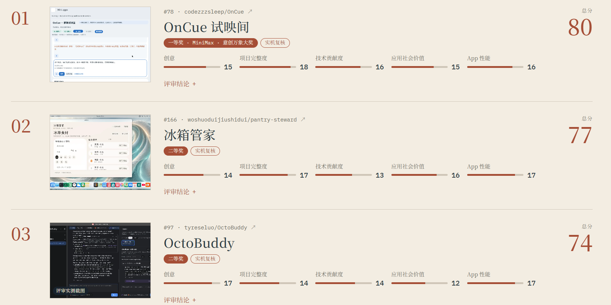

# 赛后复盘 · 我们与前三名的差距在哪里

> GOSIM Agentic App 黑客松 2026 决赛已收官。本文做三件事：
> ① 把决赛榜单和我们能确认的事实钉死；② 基于对前三名**公开仓库的一手调研**，
> 按决赛五个评分维度逐项对比；③ 给出差距归因与下次可执行的动作。
>
> **诚实声明**：我们的决赛细分项得分未在留存材料中查到，本文不猜测自己的分数；
> 所有关于对手的事实均来自其公开仓库（文末附来源），标注「推断」处是分析而非事实。
> 初赛成绩 73/100（评审版 v0.1.0 @ `9c7c322`）与「决赛未获奖」为确认事实。

---

## 一、最终结果（确认事实）

| 名次 | 作品 | 总分 | 创意 | 项目完整度 | 技术贡献度 | 应用社会价值 | App 性能 | 奖项 |
|---|---|---|---|---|---|---|---|---|
| 1 | [OnCue 试映间](https://github.com/codezzzsleep/OnCue) | **80** | 15 | 18 | 16 | 15 | 16 | 一等奖 + MiniMax 意创万象大奖 |
| 2 | [冰箱管家 pantry-steward](https://github.com/woshuoduijiushidui/pantry-steward) | **77** | 14 | 17 | 13 | 16 | 17 | 二等奖 |
| 3 | [OctoBuddy](https://github.com/tyreseluo/OctoBuddy) | **74** | 17 | 14 | 14 | 12 | 17 | 二等奖 |
| — | **牵线 · 聚会筹办守护（我们）** | 未获奖 | — | — | — | — | — | 决赛入围 |

三个直接观感：

1. **二等奖线是 74 分**——一等奖与二等奖差 6 分，二等奖内部只差 3 分，
   我们与奖项的距离是个位数量级，不是代差。
2. **没有全能选手**：冠军 OnCue 创意只比冰箱管家高 1 分；OctoBuddy 创意 17 全场最高、
   社会价值 12 也是全场最低（推断：纯开发者工具 + 仅 macOS + 实际用户≈0 拉低了叙事上限）。
   五个维度各有活法。
3. **完整度是头部作品的共同护城河**：前三名完整度 18/17/14——
   而 74 分的 OctoBuddy 完整度只有 14。**完整度和总分相关性最强**，
   这恰好是我们决赛投入最多的维度，方向没错，深度差口气。

---

## 二、对手画像（来自一手仓库调研）

### 冠军 · OnCue 试映间（80）——「验证工程驱动的 agentic 应用」

- **一句话**：Rinx 里的「群聊试映室」——读已授权的 Matrix 群，宿主助手按你的目标写三种说法，
  **程序逐条核对事实**（出处 ID、中文数字/单位、承诺句式），人两步确认发送，
  发后用真实回复对照预想给下一句。核心公式：**「助手写措辞，程序做核对，人来做决定」**。
- **技术形态**：OctoScript script-app（main.splash ~195KB），8 项宿主服务声明，
  应用不联网不持密钥；官方 Rinx 1.3.0 零补丁真机运行；MiniMax-M2.7 模型。
- **最强项（完整度 18 分的来源）**：三层验证体系——注入界面场景 75 个 85 次运行全过、
  12 套 437 项逻辑断言在真实 card-host VM 跑生产函数（仅事实核对这个函数就 157 项断言）、
  真机闭环实拍；**每段证据绑定 main.splash 的 SHA-256**，可离线复核。
- **短板**：全程人审、零主动性（无提醒无自动执行）；上游贡献是一个 **open 未合并** 的 PR
  （App-Flow #192，splash-app-verify 测试技能）；150 秒模型等待是结构延迟；无并发/压力指标。
- 来源：[仓库 README 与元数据](https://github.com/codezzzsleep/OnCue)、
  [App-Flow PR #192](https://github.com/OctoSense-org/OctoSense-App-Flow/pull/192)

### 亚军 · 冰箱管家（77）——「事实 vs 推荐严格分离的数据伦理作品」

- **一句话**：家庭冰箱食材闭环（建档→库存→周期食谱→缺菜补货→摄入记录→复盘），
  合法性完全建立在「只有**实际吃完确认**才动库存和摄入」上。
- **技术形态**：OctoScript script-app（main.splash ~443KB），宿主 `model.complete@2`，
  密钥留宿主不收集；图片/语音能力依赖**自家 fork 的改版 Windows 宿主**
  （官方 card-host 拒载其 host-api-v1）。
- **最强项（完整度 17 分的来源）**：功能面极宽（画像/库存/多周期方案/AI 菜单/模拟购物/
  执行确认/轻食体验流/问管家对话）；文档体系是同侪顶级——7 份 ADR、
  **VALIDATION.md 达 159KB**、review/GATE.json、sealed pack + SHA256 发布回执、
  GitHub Actions 发布流；README 主动单列 **Unverified 清单**（真实模型/官方宿主安装等未验证项），
  材料可信度极高。
- **短板**：**技术贡献度 13 分全场最低**——零上游 PR/issue，纯消费宿主线，
  还依赖 fork 宿主；创意 14：赛道常见。
- 来源：[仓库](https://github.com/woshuoduijiushidui/pantry-steward)、
  [App Hub #166](https://github.com/OctoSense-org/OctoSense-App-Hub/issues/166)

### 季军 · OctoBuddy（74）——「宿主收回验收权的双环编程应用」

- **一句话**：给 OctoSense 的双环 coding 应用——外环把需求拆成 slice，
  内环（Claude Code/Codex/pi/octos 任选）并行施工；**agent 只干活，算不算完成
  由宿主自己跑检查 + 读回决定**。7 条架构不变量成文。
- **技术形态**：Rust + Makepad 原生应用（lib.rs 405KB / orchestrate.rs 230KB 巨型文件），
  仅 macOS 且未公证（需手动绕过 Gatekeeper）。
- **最强项（创意 17 分全场最高）**：声明核对（agent 自称 verified 逐条对账宿主自跑结果，
  标 ✓/✗/?，近似宁可 ? 不 ✗）+ 验收闸（失败/被驳/越界拒绝 accept，override 写明理由给用户）+
  回执读回（commit/发布/审核四项读回落 receipts.jsonl）+ untrusted 块隔离第三方文字 +
  liveness 四态（working/waiting/silent/done + 等谁 + 从何时起）。
- **短板**：完整度 14——多条链路实测停在中间步、e2e 靠 stub；社会价值 12——
  纯开发者工具、无 C 端场景、实际用户≈0、0 star；两个上游 PR（OctoSense#344 / App-Hub#219）
  均未合并。
- 来源：[仓库](https://github.com/tyreseluo/OctoBuddy)、
  [docs/作品让项目多了什么.md](https://github.com/tyreseluo/OctoBuddy/blob/main/docs/作品让项目多了什么.md)

---

## 三、逐项对比：我们差在哪 / 强在哪

### ① 创意（对手：15 / 14 / 17）

我们的创意底座其实不弱：「一条群消息长成一个被照顾到收尾的完整活动」、
PLAN 协议 + 人拍板的信任模型、沉默留痕（"考虑过但没说的事"可回看）在调研中是全场独有。
OctoBuddy 能拿 17 的启示是：**创意分不只看想法，更看想法被提炼成一句话公式的锐利度**
（"助手写措辞，程序做核对，人来做决定"；"agent 只干活，宿主验完成"）。

- **差距（推断）**：我们的创意叙事分散在功能列表里，缺少一个像对手那样
  **一句可复述的公式**；演示视频讲了流程，没有先把"为什么这是agentic而不是自动化"讲透。
- **动作**：下次材料首页只放一句话公式 + 一个反直觉设计决策（如"管家最大的主动，
  是知道什么时候闭嘴"——沉默留痕天然就是这个故事）。

### ② 项目完整度（对手：18 / 17 / 14）——决定性维度

这是我们和头部差距最大的地方，输法非常具体：

| 对手做法 | 我们的现状 | 差距 |
|---|---|---|
| OnCue：437 项逻辑断言在**真实 VM 跑生产函数**，证据绑定源码 SHA-256 | 我们的 40/40 回归是真 card-host 驱动，但证据分散在多份 evidence 文档 | 证据的组织密度与可机检性 |
| OnCue：75 个注入场景 85 次运行（含授权四态、竞态、迟到回包作废） | 我们有边界用例与失败态表，但没有成体系的**注入场景矩阵** | 失败态的系统性展示 |
| 冰箱管家：VALIDATION.md 159KB + 主动列 Unverified 清单 | 我们有核验地图与验证级别标注，但"未验证项"埋在段落里 | 「诚实」本身的材料化程度 |
| 三家：**材料都是一等公民**（PPT、B 站视频、evidence 目录、发布回执） | 我们材料全，但**索引叙事弱**——评委要自己拼 | 材料的策展 |

- **动作**：建一份带日期的 VALIDATION 台账（什么/何时/怎么验的/证据链接/未验证项清单），
  把「未验证」从段落提到表格；把竞态场景（AI 回调迟到、429 限流、双实例并发）
  做成注入矩阵；终版必须在**官方 Rinx 零补丁**下跑完整生命周期并留哈希绑定的证据。

### ③ 技术贡献度（对手：16 / 13 / 14）——我们的相对强项

这是我们唯一可能反超冠军的维度，值得单说：

| 队伍 | 上游贡献 | 状态 |
|---|---|---|
| OnCue | App-Flow PR #192（测试技能，+3746 行） | open 未合并 |
| 冰箱管家 | 无 | — |
| OctoBuddy | OctoSense#344 + App-Hub#219 | 均未合并 |
| **我们** | **5 个 PR（App-Hub #230 / makepad #125 #124 / Rinx #91 / App-Flow #190）+ #213/#214 带二次证据的 issue + #490 诚实撤回** | 待审/已关 |

我们的 issue 纪律（最小复现脚本全文、双侧日志、排除项清单、平台矩阵）甚至写进了
工作区纪律。冰箱管家 13 分、两家未合并 PR 的 14-16 分，说明这个维度的给分
与「PR 是否合并 + 证据是否扎实」强相关。
- **差距**：贡献窗口（10/18–10/31）在赛后——决赛评分时我们的 PR 同样未合并，
  优势没有兑现成差异化叙事。
- **动作**：下次把上游贡献做成**对比表**放进答辩材料（我们 vs 全场的 PR/issue 数与证据质量），
  而不是埋在 README 末尾。

### ④ 应用社会价值（对手：15 / 16 / 12）

OctoBuddy 的 12 分证明：**C 端生活场景在这个维度有结构性优势**——我们是 C 端，
冰箱管家靠"反食物浪费 + 健康饮食"拿到 16。
- **差距（推断）**：我们的社会价值叙事停在了"聚会组织者的工具"，
  没有上探到"熟人社交的履约基础设施"这类更大的框；AA 催收的得体性、
  群体协调的公平性这些有社会张力的设计，在材料里只是功能点。
- **动作**：把「谁该付下一笔事前消解」「催收永不公示名单」这类
  **有社会议题背书的微决策**写成设计主张章节——它们本来就是我们从真实争议
  （微信群收款公示翻车）里提炼的。

### ⑤ App 性能（对手：16 / 17 / 17）

三家都在 16-17，说明这个维度拼的是工程纪律而非极限指标。
我们有冷启动实测、40/40 回归零渲染错误、字节级 pack 校验，基础不差。
- **差距**：**没有量化性能证据**——无启动耗时、内存占用、模型等待时延的基准报告
  （OnCue 的 150s 模型等待至少被明示并做了协议设计对冲）。
- **动作**：下次交付一份一页性能基准（冷启动/常驻内存/回合时延/降级路径耗时），
  并主动披露最差的数字——对照冰箱管家的 Unverified 清单，主动披露反而加分。

---

## 四、总归因：四句话

1. **我们输在证据策展，不是功能。** 40/40 回归、双实例 e2e、真模型真宿主链路都有，
   但对手的每一项主张都有「哈希绑定的证据 + 未验证清单」托底，我们的材料需要评委自己考古。
2. **我们的一句话公式不够锐利。** 三个对手各有一句全行业能复述的话，我们的
   "agent 提案、程序校验、人来拍板"其实同等级，但出现得太晚、藏得太深。
3. **创意分与场景大小无关，与叙事角度有关。** OctoBuddy 用一个纯开发者工具拿了
   全场最高创意——角度 > 题材。
4. **技术贡献是我们的真实长板但未被兑现。** 5 PR + issue 纪律全场最优，
   却因都在"待审"状态而没有变成评委桌上的差异。

## 五、我们不该丢的东西（差异化资产清单）

复盘不只找差距，也要记住哪些是只有我们做了、且做对了的——这些是下一次的弹药：

- **沉默留痕**：agent「考虑过但没说」的决策落盘可回看——三个对手都没有主动性，
  而我们把主动性的克制做成了可审计的功能。
- **PLAN 协议 + 12 op 白名单**：agent 可操性做到 ops 覆盖矩阵（18 状态变更全函数级），
  比 OnCue 的"全程人审"更接近「第二看 Agentic 完成度」的满分口径。
- **真实场景闭环**：时间收敛 → 冲突检测 → 待定/已确认 → AA 对账 → 催收 → 结案回顾，
  官方日历场景的核心动词逐条对齐，且有官方桌面 shell 实机运行实拍。
- **no-facts 与诚实撤回的文化**：#490 误判主动撤回并留回归测试防疑云——
  这种纪律在短期材料里不显眼，长期是信誉资产。
- **双环开发方法本身**（内外环分立、读回断言、对抗性自审）——OctoBuddy 把类似方法
  做成了作品（拿了创意 17），我们继续把它用在 Android 端侧推理的 QA 上。

## 六、来源与可信度

| 来源 | 用途 |
|---|---|
| <https://github.com/codezzzsleep/OnCue>（README、releases、PR #192） | 冠军画像与五维分析 |
| <https://github.com/woshuoduijiushidui/pantry-steward>（README、ADR、VALIDATION.md、App Hub #166） | 亚军画像与五维分析 |
| <https://github.com/tyreseluo/OctoBuddy>（README、docs/loops-architecture.md、docs/作品让项目多了什么.md、releases） | 季军画像与五维分析 |
| [leaderboard.png](leaderboard.png)（官方榜单截图） | 最终得分与排名 |
| [changes.md](../changes.md)、[evidence/](../evidence/)、仓库 tag v0.1.0→v0.10.1 | 我方事实 |

标注「推断」的段落为基于上述事实的分析判断；对手仓库在赛后可能继续演进，
本文描述以调研时（赛后复盘时点）的公开状态为准。
